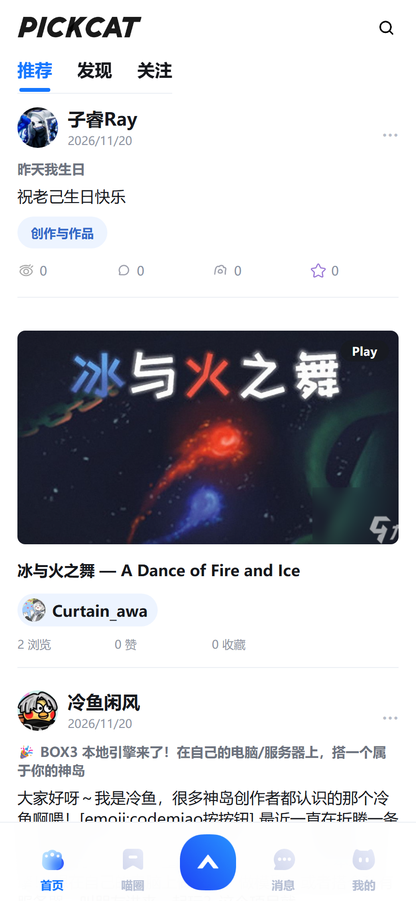
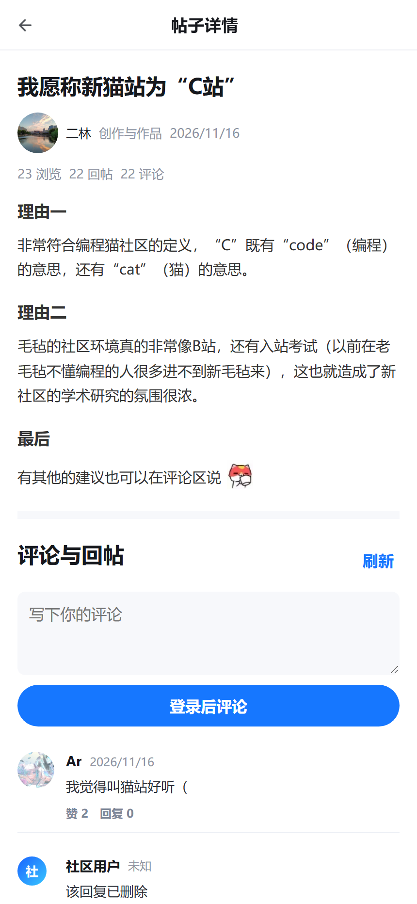
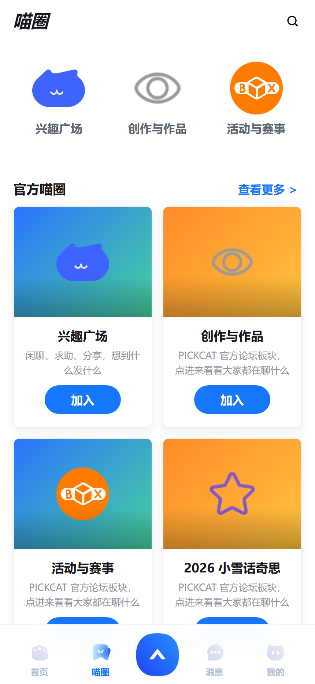
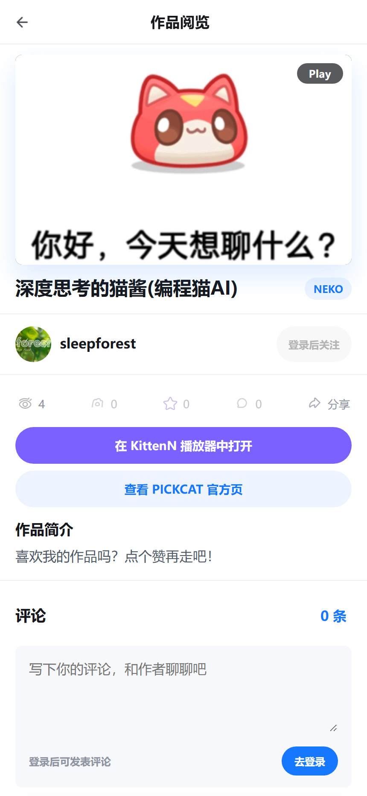
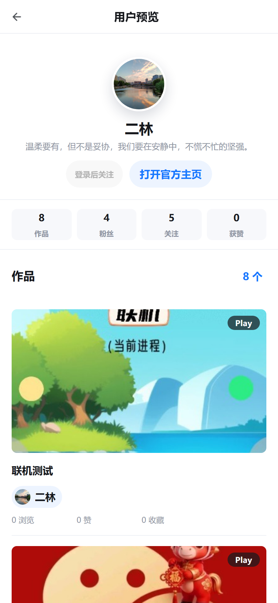

# PICKCAT 正式网页版

**UI 直接用 Pickcat-Reborn 那一套**（`index.html` + `styles.css` + `app.js` + `public/assets`，手机端优先的
Pickcat 原生观感，一行样式没重做），**只把数据层整体换成官方 API**：
`https://pickcat.dao3.fun/api/v1`（119 条路由）。

- 页面：首页推荐/发现/关注流、喵圈（板块）、帖子详情与楼中楼、搜索、作品详情与评论、用户主页、消息、我的
- 数据：全部来自官方接口，**没有一条模拟数据**
- 登录：官方 `POST /session` 必须过阿里云验证码，改为导入 `pickcat_session`（页面内直接粘贴）
- 迁移映射：[docs/api-migration.md](docs/api-migration.md) · 路由清单：[docs/api-inventory.md](docs/api-inventory.md)

## 快速开始

```bash
cd pickcat-web
node server.mjs          # http://127.0.0.1:4173
```

浏览器打开 <http://127.0.0.1:4173/>（手机访问同一局域网 IP 即可，UI 本来就是移动端布局）。

### 连接账号（发帖 / 点赞 / 通知 / 我的）

1. 在 <https://pickcat.dao3.fun/login> 完成滑块登录；
2. DevTools → Application → Cookies → 复制 `pickcat_session` 的值；
3. App 里进入「我的 → 去登录」，粘到任意一个输入框点「连接」；或
   ```bash
   curl -X PUT http://127.0.0.1:4173/__session \
     -H 'Content-Type: application/json' -d '{"cookie":"<值>"}'
   ```
4. 会话保存在本机 `data/session.json`；`DELETE /__session` 断开。

## 页面预览

| 首页（官方推荐/帖子流） | 帖子详情（官方 cookedHtml + 楼中楼） |
| --- | --- |
|  |  |

| 喵圈（官方 tags 作为板块，图标复用原 UI 素材） | 作品详情（带返回按钮） | 用户主页 |
| --- | --- | --- |
|  |  |  |

## 架构：换数据层，不换 UI

```
pickcat-web/
├── server.mjs              # 静态托管 + /api/v1 同源反代（只转发 Cookie，不保存会话）+ /proxy/media + /legacy 兼容层
├── web/
│   ├── index.html          # ← Reborn 原版页面（仅改登录文案/标题/免责声明）
│   ├── styles.css          # ← Reborn 原版样式，未改
│   ├── app.js              # ← Reborn 原版逻辑，仅替换 `const api = {...}` 与登录函数
│   ├── auth.js             # ★ 客户端登录态：Cookie 读写、校验、过期检测、登出
│   ├── api-official.js     # ★ 官方 API 适配层（把官方响应映射回 Reborn 期望结构）
│   └── public/assets/      # ← Reborn 原版 50 个图标/背景资源
├── lib/                    # 通用 SDK（api-endpoints.js 119 条路由 + client.js 语义化封装）
├── docs/                   # 迁移映射、路由清单
└── scripts/                # 路由/文档生成、UI 探针、截图、端到端校验
```

具体改动只有三处（见 `scripts/patch-app.mjs`，可重复执行）：

1. `const api = { ... }` → `const api = window.PickcatOfficialApi;`
2. `submitLogin()` → 改成 `pickcat_session` 会话导入
3. `init()` 增加 `await hydrateOfficialSession()`
4. 删除 Oldsquaw 合作专区（首页/发现/关注/喵圈 / 发布面板 / 作品页工具入口）
5. 新增全局返回按钮：`detail / work / user / tool / login / publish` 顶部「← 返回」
6. 板块图标改为复用原 UI 素材（`ic_prefecture_flag` / `ic_home_posts_play` / `item_search_views` / `box` …）按 slug 稳定分配

`web/api-official.js` 负责 Reborn 期望的字段 ↔ 官方字段的互转，例如：

| Reborn 期望 | 官方实际 |
| --- | --- |
| `work_name / preview / view_times / praise_times` | `workName / screenshotCoverUrl / viewCount / likeCount` |
| `post.content`（HTML） | `topic.firstPost.cookedHtml` |
| `reply.content` | `post.cookedHtml`（含 `children[]` 楼中楼） |
| `boards()` → `{id,name}` | 官方无 boards，用 `/topics` 的 `tags[]` 聚合，`id = tag.slug` |
| `boardPosts(boardId, page)` | `/topics?tag=<slug>&cursor=`（游标缓存模拟 page） |
| `comments / replies / fans / following` | `/works/{id}/comments`、`/topics/{id}/posts`、`/users/{id}/followers`、`/users/{id}/following` |
| `messageRecord(type)` | `/notifications`（映射成 Reborn 的消息卡结构） |

官方接口没有的能力（话题搜索、关注流、点赞聚合等）在
[docs/api-migration.md](docs/api-migration.md) 的「缺失接口降级表」里逐条说明降级方案。

## 校验

```bash
node scripts/verify.mjs                     # 端到端 16 项：反代、二进制、legacy 兼容层、401 拦截
node scripts/probe-ui.mjs http://127.0.0.1:4173/ shot.png 430 932   # UI 探针：截图 + 控制台错误 + 关键节点计数
```

实测：首页 71 张卡片、喵圈 10 个板块、帖子详情 16 层楼中楼、用户主页真实粉丝列表，控制台 0 错误。

## 站内登录（账号密码 + 阿里云滑块验证码）

现在可以在 App 里直接登录，不用再手动粘 Cookie。流程和官方登录页完全一致：

```
GET  /api/v1/captcha-config?purpose=login      → { provider: ALIYUN_CAPTCHA, region: cn, prefix: 1rbvwn, sceneId: 1icer78a }
加载 https://o.alicdn.com/captcha-frontend/aliyunCaptcha/AliyunCaptcha.js
initAliyunCaptcha({ SceneId, prefix, mode:'popup', button:'#pickcat-login-btn', captchaVerifyCallback })
用户拖动滑块 → 回调拿到 captchaVerifyParam（JSON 字符串，含 sceneId / certifyId / deviceToken）
POST /api/v1/session { account, password, captchaVerifyParam }
201 + Set-Cookie → server.mjs 转写为本机同源 Cookie → 客户端登录态成立
```

实现位置：`web/login.js`（SDK 装载与初始化）+ `web/auth.js` 的 `loginWithPassword()`。

- **201**：登录成功，`pickcat_session` 落到浏览器，自动进入「我的」
- **202**：账号需要二次验证（安全流程），提示去官方站完成一次
- **401/403**：账号或密码不正确
- **429**：尝试过于频繁

登录页保留「没有账号密码？用 Cookie 登录」作为备用入口（老用户/无法过滑块时）。

已实测（headless Edge，假账号）：

```
STATUS: 已就绪：输入账号密码后点「登录」，按提示拖动滑块
LOGIN POSTS: {"account":"TARGET_ACCOUNT@example.com","password":"TARGET_PASSWORD",
              "captchaVerifyParam":"{\"sceneId\":\"1icer78a\",\"certifyId\":\"BgxqwuSWmG\",\"deviceToken\":\"V0VC…\"}"}
AFTER: 登录失败：账号或密码不正确   ← 验证码链路通了，只是账号是假的
```

也就是说：验证码 SDK 初始化、滑块/无痕验证、`captchaVerifyParam` 生成、POST 结构、Cookie 回写这几段都是通的，
换成真实账号密码即可直接登录。
## 登录态放在客户端（server 不再保存会话）

之前的做法是 Cookie 存在服务端 `data/session.json`，前端只是问服务端"登没登"。
现在登录逻辑整体搬到浏览器：

| 环节 | 位置 |
| --- | --- |
| 保存 Cookie | 浏览器 Cookie `pickcat_session`（同源 `Path=/`，Max-Age 30 天）+ `localStorage` 备份 |
| 每次请求带登录态 | 浏览器自动带 Cookie；`server.mjs` 原样转发给 `pickcat.dao3.fun`，自己不留副本 |
| 官方轮换 Cookie | 上游 `Set-Cookie` 去掉 `Domain/Secure`、改 `SameSite=Lax` 后回写浏览器 |
| 校验 / 过期检测 | `web/auth.js` → `GET /api/v1/session`，401 判定过期 |
| 迁移/导入 Cookie | `PickcatAuth.importCookie(raw)`：支持 `pickcat_session=xxx`、整段 Cookie 串、纯值三种粘贴 |
| 登出 | `PickcatAuth.logout()`：调 `DELETE /api/v1/session` + 清 Cookie/备份/缓存 |
| 服务端 | 只在启动时读 `PICKCAT_SESSION` 作为兜底（便于 curl），**不落盘** |

`/__session` 接口保留，但语义变成「校验器」：`GET` 校验当前浏览器 Cookie，`PUT` 校验传入的 Cookie 并回 user，`DELETE` 清兜底。

> 代价说明：把会话放在客户端意味着同源 JS 能读到 `pickcat_session`（XSS 风险由应用自身承担）；换来的是刷新/多标签共享登录态、server 可无状态部署、`docker`/静态托管都能直接跑。
## 按原版社区截图做的 UI 还原

参考帖（原作者：旁观者JErS）：

- 入新社区初代体验团的所见所闻（十九）<https://shequ.codemao.cn/community/403032>
- （二十）pickcat使用小技巧 <https://shequ.codemao.cn/community/419825>
- （十六）<https://shequ.codemao.cn/community/384098>

截图已存 `reference/shequ/img/`（26 张，5.5MB），逐张比对后落地的改动：

| 原版截图里的样子 | 现在的实现 |
| --- | --- |
| 二级页「‹ 返回 + 居中标题」 | 实心白色头部条（52px + 底部细线）、左侧纯图标返回、标题居中；正文在头部下方滚动，不再出现半透明顶栏叠字（喵圈/我的/消息 仍是大标题左对齐） |
| 喵圈：圆形入口 + 官方喵圈卡片（封面 + 人数浮层、居中标题/简介、单个「加入」） | 板块卡改成 `circle-cover` + `circle-count` 左下浮层 + 居中正文 + 蓝色「加入」；「查看更多」可展开全部板块 |
| 作品预览卡：封面右上角 `Play` 胶囊 | `.play-badge`；官方占位封面（纯色图）用 canvas 采样识别后换成「PICKCAT 作品」品牌占位 |
| 帖子动作行：浏览 / 评论 / 点赞 / 收藏 四个图标 | 改成 `ic_view / ic_home_comment / ic_home_rec_pick / ic_collect`，计数映射真实 `viewCount / replyCount / likeCount / bookmarkCount` |
| 我的：`关注 12   粉丝 5` 文字行 + 昵称旁编辑铅笔 | `.profile-follow-row` + `.name-edit`（不再用 ID/作品/粉丝/关注 胶囊） |
| 发布面板：创作工具 4 个圆形图标 + 发布动态（图文/视频） | 保留 Nemo / Kitten / KittenN / 海龟 + 图文 / 视频，文案改成「发布作品」 |

没做的部分：原版板块卡的真实封面照片、投票帖（原版社区的投票组件，官方 API 无对应类型）。
### 二级页头部修正（截图里"叠字/胶囊压在正文上"的问题）

- 之前：顶栏是 96% 透明白 + 悬浮白胶囊返回按钮，滚动时正文从半透明顶栏和胶囊下透出来，看起来像错位
- 现在：`detail / work / user / tool / login / publish` 一律用实心白头部（高 52px + 底边线），返回按钮改成左侧纯图标（`imoji_back.png`，无底色），标题居中 17px；`.app` 顶部留白同步加到 64px
- 帖子正文里的 `h1~h4` 收到 `1.12em`，表情图约束为 `max-height:2em` 内联，不再出现 2 倍大标题和巨型表情
## 作品播放（之前"跑不起来"的原因）

原实现用**作品 UUID** 拼 `<engine>/player/{uuid}`，地址全是错的，所以点「用 Kitten 播放」只有黑屏。
现在按官方 AI 客户端同样的规则，用 `sourceWorkId`（数字源站 id）+ 作品类型拼播放地址：

| 类型 | 播放地址 |
| --- | --- |
| `KITTEN4` | `https://player.codemao.cn/new/{sourceWorkId}` |
| `KITTEN3` | `https://player.codemao.cn/old/{sourceWorkId}` |
| `NEKO`（KittenN） | `https://kn.codemao.cn/player?type=2&workId={sourceWorkId}` |
| `NEMO` | `https://nemo.codemao.cn/w/{sourceWorkId}` |
| `COCO` | `https://coco.codemao.cn/editor/player/{sourceWorkId}?channel=h5` |
| `WOOD`（海龟） | `https://turtle.codemao.cn/player/h5/{sourceWorkId}` |
| `MOSS` | 官方 `player.entryUrl`（带签名，直接可用） |

规则来源：官方前端 `2UJqkhfh.js` 里的 `KITTEN3/KITTEN4/NEKO/NEMO/COCO/WOOD` → player URL 映射，逐条对齐。
实测「万梗卡（WOOD）」可直接在页内跑起来（海龟播放器正常加载作品）。

### MOSS 等播放器兼容

官方一共 7 种作品引擎：`MOSS / NEKO / KITTEN4 / KITTEN3 / NEMO / COCO / WOOD`。
前 6 种用 URL 规则直接拼播放器地址；**MOSS 是例外**：它在 `moss.pickcat.dao3.fun` 上，会校验
`Origin`，并且需要 MOSS 自己的会话（不是 PICKCAT 的）。

实现分三层：

1. **反代**：`/moss/*` → `https://moss.pickcat.dao3.fun/*`
   - `Origin/Referer` 固定成 MOSS 自己的源（否则返回 `ORIGIN_NOT_ALLOWED`）
   - 整段浏览器 Cookie 透传（PICKCAT 的 + MOSS 自己的）
   - HTML 注入 `<base href="/moss/">`、根相对链接改写，并把「前往登录」改成 `/moss/sso`
   - `Set-Cookie` 回写浏览器（`__Host-` 前缀保留 `Secure`，否则浏览器会拒收）

2. **SSO**：`GET /moss/sso` 用 PICKCAT 会话跑一遍 OIDC
   ```
   moss /api/v1/auth/login        → 302 pickcat /api/v1/oidc/auth?...
   pickcat /oidc/auth             → 303 /oidc/interaction/<id> → 302 /login（已登录则直接回调）
   moss /api/v1/auth/callback     → 下发 MOSS 会话 Cookie
   ```
   服务端带 Cookie Jar 跟跳转，最后把 MOSS 域下的 Cookie 回写成本机 Cookie。

3. **播放**：点 `Play`
   - MOSS → 先 `await /moss/sso`，成功则 iframe 打开 `/moss/api/v1/player/play/{sid}/{token}`
   - 失败 → 播放区显示「请先登录 PICKCAT 账号 / 重新登录 PICKCAT / 打开官方页 / 返回作品页」
   - 非 MOSS → 直接用官方播放器地址内嵌

实测：

```
# MOSS 播放器经反代在本站运行（未登录状态）
GET /moss/api/v1/player/play/f281b926-…/4_y2Nh9…  → 401 + 「登录 MOSS 后即可播放 / 请使用 PICKCAT 账号登录」
# SSO 链路（用伪造会话验证跳转顺序，说明链路正确，缺的只是有效会话）
/moss/sso → moss /api/v1/auth/login(302) → pickcat /api/v1/oidc/auth(303)
          → pickcat /oidc/interaction/…(302) → pickcat /login(200，未登录)
```

> MOSS 播放地址（带签名 token）只在下发数据里出现：推荐流 `player.entryUrl`，或**登录后**的
> `GET /works/{id}`。所以登录 PICKCAT 后，MOSS 作品会先拿到 entryUrl，再经上面三步落地播放。
### 游玩界面按原版重排

- 作品页：封面右上角 `Play` 胶囊（点封面即玩），不再是覆盖整个封面的「用 Kitten 播放」大按钮 + 提示语
- 动作栏：浏览 / 点赞 / 收藏 / 评论 / 分享 五个图标（对齐原版）
- 「在 <引擎> 播放器中打开」+「查看 PICKCAT 官方页」两个入口
- 点 Play 后进入全屏 iframe 播放（`player-landscape`），左上角返回退出
- 兜底：部分编程猫作品在官方播放器里会要求**编程猫账号登录**（播放器自身的风控），此时底部提示条提供「新窗口打开播放器 / PICKCAT 官方页」两条出路
## 已知限制

- 写操作需要有效会话；`POST /posts`、`POST /works/{id}/comments` 的字段官方未公开，服务端校验失败会原样回显。
- Oldsquaw 合作专区及 BetterNemo / CoCo Pro / KN-Oldsquaw / 控件编辑器 等本地工具入口已按需求移除
  （原包 166MB 未随仓库打包）；发布面板只保留 Nemo / Kitten / KittenN 三个官方创作入口。
- `pickcat_session` 会在官方侧过期（实测 401）。过期后「我的 / 消息 / 点赞评论」会回到登录引导，重新导入 Cookie 即可。
- 封面 CDN（`creation.bcmcdn.com`）个别链接 404，属于官方源数据问题。
- 第三方独立客户端，与 PICKCAT 官方无关联，数据均来自公开 API，仅供学习交流、禁止商用。

## 版本

- v1.0.0 —— 2026-11-20：Reborn UI + 官方 API（119 条路由）全量迁移
